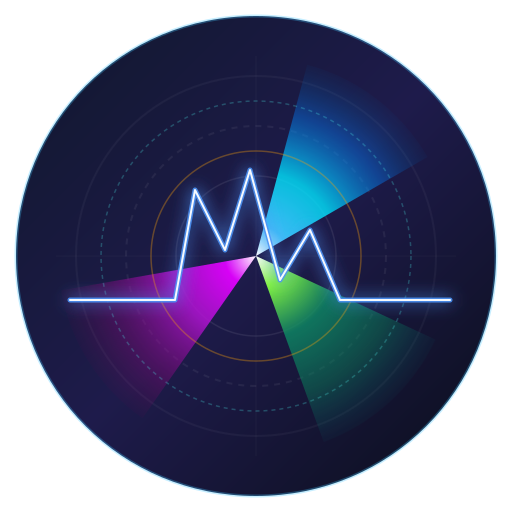

# Status Monitor

<p align="center">
  
</p>

<p align="center">
  <b>A lightweight, real-time Android system resource telemetry and floating window monitor built with Flutter and AI.</b>
</p>

<p align="center">
  
  
  
  
</p>

---

## 🚀 Features

### ⚡ 1. Real-Time CPU Telemetry
- **Dual Computation Modes**:
  - **Time-Occupied (Jiffies)**: Kernel `/proc/stat` active time slices across all CPU cores.
  - **Frequency-Weighted (DVFS)**: Time-in-state weighted by core clock frequency and scaling capacities.
- **Hardware Diagnostics**: Per-core online status, current/min/max clock frequencies, and core architecture view.
- **Precision Charts**: Real-time line charts tracking current, minimum, average, and peak CPU load with zero curve clipping.
- **Color Theme**: Dodger Blue (`#1E90FF`) primary and Orange (`#FF9100`) secondary metrics.

### 💾 2. Memory (RAM) Tracking
- **Live Memory Usage**: Real-time RAM allocation percentage and physical memory load (in GB).
- **Comprehensive Statistics**: Automatic min, average, and peak load tracking with dynamic scaling.
- **OLED Dark Mode**: Optimized high-contrast dark theme for low power consumption on OLED screens.

### 🌐 3. Network Throughput
- **Bandwidth Monitoring**: Real-time upload and download traffic speed tracking using kernel `TrafficStats`.
- **Exponential Moving Average (EMA)**: Smooth rate smoothing to eliminate erratic network spikes.
- **Jitter-Free Typography**: Monospace layout with strict character-width alignment (`KB/s`, `MB/s`, `GB/s`).

### 🔔 4. Persistent Status Bar Notifications
- **Edge-to-Edge Status Icons**: High-contrast, dynamic bitmap icons generated on the fly via canvas path rasterization.
- **Multiple Modes**: Resource Usage (CPU/RAM), Network Speed (Value/Unit), or Dual simultaneous status bar icons.
- **One UI & AOSP Compatible**: Optimized notification grouping and priority handling for modern Android OEM skins.

### 🪟 5. Customizable Floating Window (Overlay)
- **Desktop Floating Overlay**: Draggable rounded HUD card displaying real-time system stats over any application.
- **Position Persistence**: Automatically saves and restores overlay screen coordinates across app and phone restarts.
- **Bounded Clamping**: Smart screen-edge clamping preventing the floating window from being dragged off-screen.
- **Customizable**: Adjustable size scale (5% – 15%) and opacity (30% – 100% in 10% steps).
- **Quick Launch**: Optional tap-to-open gesture to bring the main application to the foreground.

### 🔋 6. Deep Sleep & Battery Optimization
- **Automatic Screen-Off Sleep**: Dynamically listens to `ACTION_SCREEN_OFF` and immediately pauses all background polling, canvas drawing, and notification updates.
- **Zero WakeLock Overhead**: Never holds wake locks, allowing the device to enter Linux deep sleep (Suspend / Doze) undisturbed.
- **Instant Resume**: Instantly resumes telemetry upon `ACTION_SCREEN_ON` with baseline re-anchoring to avoid measurement skew.

### 🎨 7. Modern Adaptive & Themed Icons
- Android 13+ Themed Icons (`monochrome`) compatible with Material You dynamic color tinting.
- High-definition radar and waveform vector design.

---

## 🛠️ Tech Stack & Architecture

- **UI Framework**: Flutter (Dart)
- **State Management**: `provider` (`ChangeNotifier`)
- **Charting Engine**: `fl_chart`
- **Native Android Core**: Kotlin (`MonitorForegroundService`, `MainActivity`)
- **Inter-Process Communication**: Flutter Platform Channels (`MethodChannel`)
- **Persistence**: `SharedPreferences`

---

## 📦 Building from Source

### Prerequisites
- [Flutter SDK](https://docs.flutter.dev/get-started/install) (3.x or later)
- Android SDK (API Level 24+ minimum, Target API 34+)
- Java / OpenJDK 21

### 1. Clone the Repository
```bash
git clone https://github.com/yingongsui/StatusMonitor.git
cd StatusMonitor
```

### 2. Install Dependencies
```bash
flutter pub get
```

### 3. Build Debug APK
```bash
flutter build apk --debug
```

### 4. Build Release APK (Recommended: 64-bit ARM)
To produce an optimized 64-bit APK (`app-arm64-v8a-release.apk`):
```bash
flutter build apk --release --target-platform android-arm64 --split-per-abi
```

The output file will be located at:
```
build/app/outputs/flutter-apk/app-arm64-v8a-release.apk
```

---

## 🔒 Release Signing (Optional)
To sign your release builds, configure your credentials in `android/key.properties`:
```properties
storePassword=YOUR_STORE_PASSWORD
keyPassword=YOUR_KEY_PASSWORD
keyAlias=YOUR_KEY_ALIAS
storeFile=/path/to/upload-keystore.jks
```
*(Note: `key.properties` and `*.jks` are automatically ignored by `.gitignore` to prevent credential leaks).*

---

## 📄 License
This project is open source and available under the [MIT License](LICENSE).
