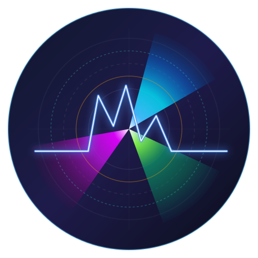

# Status Monitor

<p align="center">
  
</p>

<p align="center">
  <b>An AI-built, lightweight Android real-time system resource monitor, floating HUD overlay, and link-opener browser chooser crafted with Flutter, Kotlin, and AI.</b>
</p>

<p align="center">
  
  
  
  
  
  
</p>

<p align="center">
  <a href="#english">English</a> •
  <a href="#japanese">日本語</a> •
  <a href="#chinese">简体中文</a>
</p>

---

<a id="english"></a>

## 🌐 English

> **AI-Driven Development**: Status Monitor is designed, architected, and implemented with **AI**—combining Flutter UI engineering and native Android (Kotlin) kernel telemetry, dynamic canvas status bar icons, and browser-role link dispatching.

### 🚀 Features

#### ⚡ 1. Real-Time CPU Telemetry
- **Dual Computation Modes**:
  - **Time-Occupied**: Measures kernel active vs. idle CPU time via `cpuidle` / `time_in_state` (with `/proc/stat` jiffies fallback).
  - **Frequency-Weighted (DVFS)**: Dual-stage weighting combining intra-core frequency normalization `(freq * time) / maxFreq` and inter-core capacity scaling `maxFreq / ∑maxFreq`.
- **Hardware Diagnostics**: Dedicated CPU & Hardware view showing per-core microarchitecture detection (ARM Cortex & Qualcomm Oryon V1/V2) and live `cur / max` MHz frequencies.
- **Precision Line Charts**: Real-time `fl_chart` graphs with Min / Avg / Peak metrics, adaptive multi-line subtitles, and Dodger Blue (`#1E90FF`) + Orange (`#FF9100`) dual-metric styling.

#### 💾 2. Memory (RAM) Tracking
- **Live Allocation**: Real-time RAM percentage, `Used GB / Total GB` progress indicator, and free physical memory tracking.
- **OLED Dark Mode**: High-contrast dark theme (`#0D1117` / `#161A22`) alongside a clean light theme.

#### 🌐 3. Network Throughput
- **Bandwidth Telemetry**: Real-time download and upload speed tracking powered by Android `TrafficStats`.
- **EMA Smoothing**: Low-pass exponential moving average filtering to suppress transient spikes.
- **Jitter-Free Readouts**: Fixed-width monospace overview bar (`KB/s`, `MB/s`, `GB/s`) displaying total throughput cleanly.

#### 🔔 4. Persistent Status Bar Notifications
- **Dynamic Edge-to-Edge Icons**: Real-time bitmap icons drawn on the fly via native Android `Canvas`.
- **Flexible Modes**: Switch between **Resource Usage (CPU / RAM)**, **Network Speed (Value / Unit)**, or **Both Icons (Dual Status Bar)**, with configurable CPU calculation metrics and refresh rates (`500 ms – 3000 ms`).

#### 🪟 5. Customizable Floating Window (Overlay)
- **System-Wide HUD**: Draggable rounded overlay window (`SYSTEM_ALERT_WINDOW`) supporting **Resource Usage**, **Network Speed**, or **Both Windows (Side-by-side)**.
- **Smart Persistence & Clamping**: Automatically clamps coordinates inside screen bounds and persists window position across restarts.
- **Customizable Appearance**: Adjustable window scale (`5% – 15%`), opacity (`30% – 100%` in 10% increments), and optional **Tap to Open App**.

#### 🔋 6. Screen-Off Sleep & Battery Optimization
- **Automatic Suspend**: Listens to `ACTION_SCREEN_OFF`, `ACTION_SCREEN_ON`, and `ACTION_USER_PRESENT` to halt background polling, bitmap rendering, and notification updates while the screen is off.
- **Zero WakeLock Overhead**: Holds no wake locks so the device enters deep sleep uninterrupted, then re-anchors telemetry baselines on wake.

#### 🔗 7. Link Opener (Browser Chooser) — *New in v2.0.0*
- **Bypass Locked Default Browsers**: On modern Android versions (including Android 17+), clearing Chrome or another browser back to "Always ask" is restricted. Enabling **Link Opener** in the settings drawer activates `LinkOpenerActivity` and lets you set Status Monitor as the system default browser (`RoleManager.ROLE_BROWSER`).
- **Instant Native Chooser Dialog**: Whenever an `http` / `https` link is opened, a lightweight translucent native dialog pops up immediately over your current app—listing all installed browsers and domain-capable apps—so you can choose which browser opens each link.
- **URL Preview & Quick Copy**: Displays the link host and full URL with a one-tap **Copy** button.

#### 🎨 8. Adaptive & Monochrome App Icons
- Vector radar & waveform design with Android 13+ Material You themed monochrome icon (`ic_launcher_monochrome`) support.

---

### 🛠️ Tech Stack & Architecture

- **Development Workflow**: AI-assisted architecture, native optimization & UI engineering
- **UI Framework**: Flutter (Dart)
- **State Management**: `provider` (`ChangeNotifier`)
- **Charting Engine**: `fl_chart`
- **Native Android Core**: Kotlin (`MainActivity`, `MonitorForegroundService`, `LinkOpenerActivity`)
- **Platform Bridge**: Flutter `MethodChannel` (`com.example.statusbarshow/sysinfo`, `com.example.app/hardware`)
- **Persistence**: `SharedPreferences`

---

### 📦 Building from Source

#### Prerequisites
- [Flutter SDK](https://docs.flutter.dev/get-started/install) (3.x or later)
- Android SDK (API Level 24+ minimum)
- Java / OpenJDK 17+

#### Build Commands
```bash
# 1. Clone the repository
git clone https://github.com/yingongsui/StatusMonitor.git
cd StatusMonitor

# 2. Install dependencies
flutter pub get

# 3. Build Debug APK
flutter build apk --debug

# 4. Build Release APK (Recommended: 64-bit ARM only)
flutter build apk --release --target-platform android-arm64 --split-per-abi
```

Output path for the 64-bit release APK:
```text
build/app/outputs/flutter-apk/app-arm64-v8a-release.apk
```

#### Release Signing (Optional)
Create `android/key.properties` (automatically ignored by `.gitignore`):
```properties
storePassword=YOUR_STORE_PASSWORD
keyPassword=YOUR_KEY_PASSWORD
keyAlias=YOUR_KEY_ALIAS
storeFile=/path/to/upload-keystore.jks
```

---

<a id="japanese"></a>

## 🇯🇵 日本語

> **AI ベースで開発**：**Status Monitor** は、設計から実装・最適化まで **AI を活用して開発（AI-Built）** された、**Flutter + Kotlin** 製の軽量な Android 向けリアルタイムシステムモニター＆リンクディスパッチャーです。

### 🚀 主な機能

#### ⚡ 1. リアルタイム CPU テレメトリ・ハードウェア診断
- **2種類の計算モード**：
  - **時間占有率（Time-Occupied）**：カーネルの `cpuidle` と `time_in_state`（`/proc/stat` jiffies フォールバック対応）から CPU 稼働時間を算出。
  - **周波数重み付け（Frequency-Weighted / DVFS）**：コア内の周波数正規化 `(freq * time) / maxFreq` とヘテロジニアス・コア容量重み付け `maxFreq / ∑maxFreq` により実負荷を正確に可視化。
- **ハードウェア情報画面**：各 CPU コアのマイクロアーキテクチャ判定（ARM Cortex、Qualcomm Oryon V1/V2）とリアルタイム周波数（MHz）を確認可能。
- **リアルタイムチャート**：最小値・平均値・ピーク値の統計表示、複数行折り返し対応サブタイトル、Dodger Blue（`#1E90FF`）と Orange（`#FF9100`）のデュアルメトリクス表示に対応。

#### 💾 2. メモリ（RAM）監視
- 物理メモリ使用率、使用量 / 総容量（GB）プログレスバー、空きメモリ量をリアルタイムに表示。
- 省電力に優れた **OLED ダークモード** とライトモードの切り替えに対応。

#### 🌐 3. ネットワーク通信速度モニター
- Android `TrafficStats` を用いてダウンロード／アップロード速度をリアルタイム計測し、指数移動平均（EMA）でスパイクを平滑化。
- 上部サマリーバーでは等幅フォントで合計帯域幅（`KB/s`、`MB/s`、`GB/s`）をブレなく表示。

#### 🔔 4. 常駐ステータスバー通知アイコン
- ネイティブ Android `Canvas` により高コントラストなビットマップアイコンを動的に描画。
- **リソース使用率（CPU / RAM）**、**ネットワーク速度（数値 / 単位）**、**両方表示（デュアルアイコン）** の 3 モードを選択でき、更新間隔（`500 ms – 3000 ms`）も調整可能。

#### 🪟 5. カスタマイズ可能なフローティングウィンドウ
- 他アプリの上に重ねて表示できるドラッグ可能なオーバーレイカード（リソース／通信速度／並列 2 ウィンドウ表示）。
- **位置保存と画面端クランプ**：ドラッグ位置を自動保存し、画面外への飛び出しを防止。
- **外観調整**：サイズ（`5% – 15%`）、不透明度（`30% – 100%`・10% 刻み）、タップでアプリを開くオプションを搭載。

#### 🔋 6. 画面オフ時のディープスリープ最適化
- `ACTION_SCREEN_OFF` / `ACTION_SCREEN_ON` / `ACTION_USER_PRESENT` を監視し、画面消灯中はバックグラウンドのポーリング・描画・通知更新を自動停止。
- WakeLock を保持せず端末のディープスリープを妨げない設計で、画面復帰時に計測ベースラインを自動再同期します。

#### 🔗 7. Link Opener（ブラウザ選択ウィンドウ）— *v2.0.0 新機能*
- **デフォルトブラウザ固定への対策**：Chrome 等がインストールされた Android 17 以降の環境では、デフォルトブラウザ設定を「毎回確認」に戻すことが制限されています。設定ドロワーの `About` 上部にある **Link Opener** をオンにすることで、本アプリをシステムブラウザ（`RoleManager.ROLE_BROWSER`）として設定できます。
- **高速なネイティブ選択ダイアログ**：Web リンク（`http` / `https`）を開く際、現在のアプリ上に半透明のネイティブダイアログ（`LinkOpenerActivity`）が即座に表示され、端末内のブラウザや対応アプリから毎回好きなアプリを選んで開けます。
- **URL プレビュー＆コピー**：ドメインとフル URL の確認に加え、ワンタップでのクリップボードコピーに対応。

#### 🎨 8. アダプティブ＆モノクロームアイコン
- Android 13 以降の Material You テーマアイコン（`ic_launcher_monochrome`）に対応した透過モノクロアプリアイコンを搭載。

---

### 📦 ビルド手順（日本語）

必要環境：Flutter 3.x、Android SDK（API 24 以上）、JDK 17 以上。

```bash
git clone https://github.com/yingongsui/StatusMonitor.git
cd StatusMonitor
flutter pub get

# 64bit ARM 向け最適化 APK のビルド（推奨）
flutter build apk --release --target-platform android-arm64 --split-per-abi
```

出力先：`build/app/outputs/flutter-apk/app-arm64-v8a-release.apk`

---

<a id="chinese"></a>

## 🇨🇳 简体中文

> **基于 AI 构建**：**Status Monitor** 是一款**由 AI 驱动设计与实现**、基于 **Flutter + Kotlin** 的轻量级 Android 实时系统监控与链接分发工具，集成了状态栏实时图标、桌面悬浮窗、硬件核心频率诊断以及 **Link Opener 浏览器选择器**。

### 🚀 核心功能

#### ⚡ 1. 实时 CPU 性能监控与硬件诊断
- **双维度计算模式**：
  - **时间占用率（Time-Occupied）**：读取内核 `cpuidle` 与 `time_in_state`（支持 `/proc/stat` jiffies 回退）统计各核心活跃时间占比。
  - **频率加权负载（Frequency-Weighted / DVFS）**：采用核心内频率归一化 `(freq * time) / maxFreq` 与跨大小核容量加权 `maxFreq / ∑maxFreq`，真实反映多核异构处理器负载。
- **硬件详情页**：支持实时查看每个 CPU 核心的实时频率 / 最大频率（MHz）以及微架构识别（ARM Cortex 与 Qualcomm Oryon V1/V2）。
- **高精度实时图表**：展示当前、最小、平均与峰值曲线，采用道奇蓝（`#1E90FF`）与橙色（`#FF9100`）双曲线区分，并支持图例切换与副标题自动换行。

#### 💾 2. 内存（RAM）实时追踪
- 实时显示物理内存占用百分比、已用 / 总容量（GB）进度条与可用内存。
- 原生支持 **OLED 深色模式**（高对比度低功耗配色）与浅色模式切换。

#### 🌐 3. 网络吞吐量监控
- 基于 Android `TrafficStats` 实时采集下行与上行速率，并应用指数移动平均（EMA）低通滤波平滑瞬时波动。
- 顶部概览栏采用等宽对齐总速率格式（`KB/s`、`MB/s`、`GB/s`），避免数字跳动导致排版抖动。

#### 🔔 4. 常驻状态栏实时图标
- 通过原生 Android `Canvas` 动态光栅化生成高对比度状态栏图标。
- 支持 **资源占用（CPU / RAM）**、**网络速率（数值 / 单位）** 以及 **双图标同时显示** 三种模式，可自由调节刷新间隔（`500 ms – 3000 ms`）与 CPU 计算口径。

#### 🪟 5. 可定制桌面悬浮窗
- 支持在任意应用上层显示圆角桌面悬浮窗（需授予悬浮窗权限），提供资源占用、网络速率或并排双窗模式。
- **位置记忆与防越界**：自动保存拖动位置并在屏幕尺寸变化时将悬浮窗限制在可见边界内。
- **自由定制**：支持大小缩放（`5% – 15%`）、透明度调节（`30% – 100%`，10% 步进）以及可选的**点击悬浮窗打开主程序**功能。

#### 🔋 6. 息屏休眠与省电优化
- 自动监听系统 `ACTION_SCREEN_OFF`、`ACTION_SCREEN_ON` 与 `ACTION_USER_PRESENT` 广播：息屏后立即暂停后台轮询、位图绘制与通知刷新。
- **零 WakeLock 占用**：不持有唤醒锁，确保设备正常进入系统深度休眠；亮屏后自动重新锚定采样基准，避免出现数值跳变。

#### 🔗 7. Link Opener（浏览器选择器）— *v2.0.0 新增*
- **解决高版本 Android 无法清除默认浏览器的问题**：在 Android 17+ 等现代系统中，一旦安装了 Chrome 等浏览器，系统往往不允许将默认浏览器重置为“每次询问”。在设置侧边栏 `About` 上方开启 **Link Opener** 后，即可一键将 Status Monitor 设为系统默认浏览器（`RoleManager.ROLE_BROWSER`）。
- **轻量原生弹窗选浏览器**：每次点击 `http` / `https` 链接时，原生半透明选择窗口（`LinkOpenerActivity`）会直接悬浮在当前应用上方弹出，列出设备上已安装的所有浏览器及支持对应域名的 App，由用户自由决定用哪个浏览器打开。
- **链接预览与一键复制**：弹窗顶部展示目标域名与完整 URL，并支持一键复制链接到剪贴板。

#### 🎨 8. 自适应与 Monochrome 单色主题图标
- 支持 Android 13+ Material You 动态取色单色图标（`ic_launcher_monochrome`），背景全透明不遮挡系统色调。

---

### 📦 本地编译（简体中文）

环境要求：Flutter 3.x、Android SDK（API 24+）、JDK 17+。

```bash
git clone https://github.com/yingongsui/StatusMonitor.git
cd StatusMonitor
flutter pub get

# 仅编译 64 位 ARM Release APK（推荐）
flutter build apk --release --target-platform android-arm64 --split-per-abi
```

生成文件路径：`build/app/outputs/flutter-apk/app-arm64-v8a-release.apk`

---

## 📄 License

This project is open source and licensed under the [MIT License](LICENSE).
